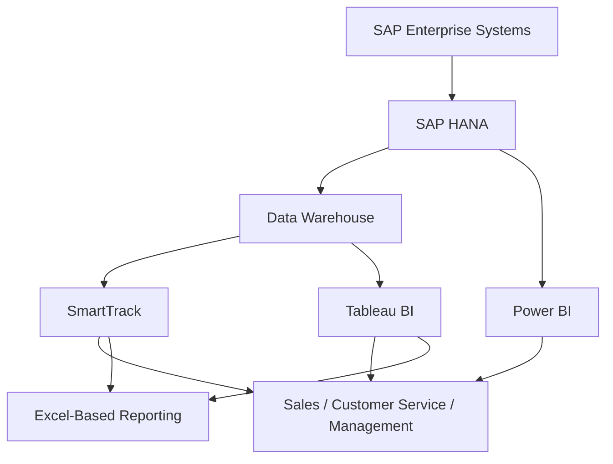

# Regional Digital Transformation & Solution Architecture Discovery
## Kimberly-Clark | LATAM Enterprise Analytics & Commercial Operations

**Engagement:** Regional Discovery, Business Analysis & Technology Assessment  
**Role Perspective:** Digital Transformation Consultant / Solution Architecture  
**Geographical Scope:** Argentina, Chile, Colombia, Peru  
**Business Domains:** Sales, Commercial Operations, Customer Service, Order Management, Credit Management, Business Intelligence  
**Technology Landscape:** SAP, SAP HANA, Tableau, SmartTrack, Power BI, Data Warehouse, Microsoft Power Apps

---

## 1. Executive Overview

Participated in a regional Discovery and Business Analysis initiative focused on assessing Kimberly-Clark's commercial analytics, business intelligence, and operational reporting ecosystem across Latin American markets.

The engagement involved stakeholder interviews, business process discovery, functional requirements gathering, technology assessment, and identification of strategic opportunities to improve enterprise reporting, data accessibility, operational visibility, and business decision-making.

The assessment covered the interaction between SAP-based enterprise data sources, SAP HANA, Data Warehouse infrastructure, and downstream BI applications, including Tableau and SmartTrack.

A central challenge was aligning business expectations with existing technical capabilities, particularly regarding data synchronization, reporting performance, regional data visibility, business metric consistency, and user adoption.

The Discovery translated operational pain points into structured functional requirements, potential architectural improvements, and a prioritized digital transformation backlog.

---

## 2. Strategic Discovery & Business Alignment

The Discovery focused on understanding how commercial stakeholders consume enterprise data to manage sales performance, customer portfolios, forecasts, order fulfillment, and financial indicators.

### Stakeholder & Business Areas

- Sales Executives and Sales Managers
- Commercial Management
- Customer Service
- Order Management
- Credit Management
- Finance
- Regional and Country-level stakeholders

### Key Business Domains

| Domain | Discovery Focus |
|---|---|
| Sales Analytics | Sell-In, Sell-Out, NIV, Net Sales |
| Commercial Forecasting | Forecast, targets, best estimates |
| Financial Reporting | P&L and customer financial performance |
| Order Management | Open Orders, blocked orders, invoicing |
| Credit Management | Credit limits, approval levels, order release |
| Customer Service | Customer portfolio and order tracking |
| Supply Chain | Inventory availability and product shortages |
| Business Intelligence | Reporting usability, performance, customization |

The regional assessment identified differences in country-level processes, business terminology, reporting requirements, and operational expectations.

The architectural challenge was to identify opportunities for regional standardization while preserving relevant country-specific business requirements.

---

## 3. Enterprise Architecture & Data Landscape Assessment

### Current-State Technology Ecosystem

The assessment covered the following conceptual data and reporting landscape:

*Conceptual representation of the assessed landscape, not a verified production architecture diagram.*

### Architectural Considerations

- Enterprise data source dependencies.
- Data Warehouse integration and reporting consumption.
- SAP HANA data access and caching behavior.
- BI application performance and refresh mechanisms.
- Data consistency across enterprise reporting platforms.
- Regional data access and visibility restrictions.
- Scalability under increasing transactional volumes.
- Reduction of manual reporting and spreadsheet dependencies.

---

## 4. Data Synchronization & Performance Discovery

One of the principal findings involved the relationship between data freshness, caching, and reporting performance.

### Observed Reporting Behavior

- Initial report loading took approximately 30 seconds.
- Subsequent queries benefited from cached data.
- Cached queries were generally faster than the initial load.
- Users reported discrepancies between SAP HANA and SmartTrack.
- Different reporting components operated with different refresh intervals.
- Users reported uncertainty regarding the actual data update timestamp.
- Country-specific timezone configuration issues affected reporting interpretation.

### Identified Refresh Intervals

| Data Domain | Observed Refresh Frequency |
|---|---|
| Invoice data | Approximately every 2 hours |
| Open Orders | Approximately every 30 minutes |
| SAP blocked-order processing job | Approximately every 15 minutes |

These different refresh cycles introduced potential temporal inconsistencies between related business indicators.

For example, users could potentially observe invoice information updated at a different time from order status or blocked-order information.

### Architecture Implications

The Discovery highlighted opportunities to investigate:

- Data freshness and synchronization strategies.
- Reporting timestamp standardization.
- Timezone normalization and localization.
- Cache invalidation and refresh behavior.
- Data consistency across reporting components.
- Query performance optimization.
- Data access patterns and unnecessary SAP queries.

The assessment also identified the importance of reducing dependency on direct SAP queries and manual extraction through SAP transactions and related reporting interfaces.

---

## 5. Business Metrics & Data Consistency

A significant business challenge involved the interpretation and relationship between commercial metrics.

### Relevant Business Indicators

- NIV
- Net Sales
- Sell-In
- Sell-Out
- Forecast
- Best Estimate
- P&L
- Invoice Sales
- Delivery on Shipment

Stakeholders expressed concerns regarding the perceived relationship between NIV and Net Sales, despite both being critical indicators for commercial operations and forecasting.

The Discovery identified a need for:

- Clearer business definitions.
- Consistent metric comparison.
- Improved reporting transparency.
- Better alignment between forecasting and invoiced sales.
- Reduced ambiguity in commercial reporting.

### NIV Complexity

NIV was identified as a particularly complex business data requirement.

Its availability and reporting evolution were linked to ongoing improvements associated with the Falcon initiative.

The Discovery documented the dependency and highlighted the need for coordination with the relevant business and technology teams.

---

## 6. BI Usability, Personalization & Adoption

The assessment identified user adoption and reporting flexibility as major transformation opportunities.

### Current-State Challenges

- Users relied heavily on Excel for detailed analysis.
- Tableau / SmartTrack reporting was perceived as relatively static.
- Users required multiple clicks to obtain frequently used information.
- Heatmap interaction and filtering capabilities were insufficient for some business scenarios.
- Users requested additional dimensions, subtotals, and historical comparisons.
- Different user profiles required different default reporting views.
- Training gaps affected the effective use of existing BI capabilities.

### Strategic Improvement Areas

**Personalization**
- Default dashboards based on user preferences.
- Role-oriented reporting experiences.
- Configurable dashboard components.
- Improved recognition of user preferences.

**Reporting Flexibility**
- Dynamic filters by account, customer, category, and sales executive.
- Improved heatmap interaction.
- Historical analysis and expanded reporting dimensions.
- Additional KPIs and subtotals.
- Expandable, collapsible, and configurable dashboard components.

**User Adoption**
- Structured training workshops.
- Improved communication regarding reporting capabilities.
- Feedback collection through surveys.
- Continuous improvement based on user experience.

A key adoption insight was that users would be more willing to reduce Excel dependency if the BI platform progressively addressed their most important analytical needs.

---

## 7. Order Management & Operational Visibility

The Discovery identified significant opportunities to improve visibility into the order lifecycle.

### Order Lifecycle

The assessed business lifecycle included:

- Order creation.
- Volume-related blocking or rejection.
- Credit-related blocking.
- Delivery-related processing.
- Order release.
- Partial or full invoicing.
- Order closure.

### Key Functional Requirements

- Historical Open Order tracking.
- Visibility into blocked-order reasons.
- Order status history.
- Delivery and invoicing dates.
- Credit-blocking status.
- Partial versus total invoicing visibility.
- Product shortages and inventory availability.
- Improved customer-level order tracking.

### Order Status Transparency

Users required better understanding of why orders were blocked or rejected, including:

- Credit restrictions.
- Product availability.
- Volume-related constraints.
- Delivery-related issues.

The Discovery also highlighted the need to distinguish relevant dates across the order lifecycle, including delivery dates, distribution-center dates, and invoicing dates.

These dates represent different business events and should not be interpreted interchangeably.

---

## 8. Mobile Application & Field Sales Enablement

The Discovery included conceptual requirements for a mobile application supporting Sales Executives and field operations.

### Mobile Functional Areas

- Sales performance.
- Customer portfolio.
- Open Orders.
- Product information.
- Alerts and notifications.
- Product scanning.
- Voice-based interaction.

### Product Scanning

A potential mobile capability involved scanning product barcodes or QR codes to retrieve relevant commercial information.

The proposed information included:

- Product name.
- Region.
- Category, subcategory, and tier.
- Actual price.
- Suggested shelf price.
- Inventory availability.
- Product shortage indicators.
- Sales performance.

### Voice Interaction

Voice-based interaction was identified as a potential usability enhancement for accessing:

- Customer sales.
- Customer Open Orders.
- Customer notifications.
- Product information.

### Mobile Architecture Considerations

- Mobile-friendly information presentation.
- Access to relevant customer and product data.
- Notification scalability.
- Integration with existing enterprise data sources.
- Potential geolocation capabilities.
- Barcode scanning functionality.

These capabilities were identified as functional opportunities rather than completed implementation features.

---

## 9. Forecasting & Commercial Planning

The Discovery identified opportunities to improve forecasting through increased ownership and participation from Sales Executives.

### Current-State Observation

Commercial targets were generally cascaded from higher management levels toward individual executives.

The assessment identified an opportunity to complement this top-down approach with bottom-up forecasting inputs.

### Potential Improvement

Introduce a Best Estimate input allowing Sales Executives to provide their expected sales performance during the month.

This could support:

- Improved forecasting accuracy.
- Increased commercial ownership.
- Better alignment between management targets and operational expectations.
- More informed sales performance monitoring.
- Improved visibility into forecast evolution.

The proposed capability would complement existing forecasting mechanisms rather than replace established enterprise planning processes.

---

## 10. Notification & Alerting Architecture

Notifications were identified as an important functional and technical improvement area.

### Potential Notification Scenarios

- Order release.
- Credit-blocked orders.
- Order rejection.
- Product shortages.
- Inventory availability.
- Changes in order status.
- Customer-specific commercial events.

### Architecture Considerations

The Discovery highlighted the need for a scalable notification capability capable of supporting multiple business scenarios.

Relevant considerations included:

- Notification relevance and prioritization.
- Event-driven business information.
- User-specific notification preferences.
- Scalability as additional use cases are introduced.
- Integration with enterprise data sources.
- Avoiding excessive or irrelevant notifications.

A potential future-state direction would involve evaluating a more flexible notification architecture supporting both desktop and mobile experiences.

---

## 11. Digital Transformation Roadmap & Functional Backlog

The Discovery findings were translated into functional improvement areas and epics for further analysis and prioritization.

### Desktop — SmartTrack / Tableau

| Epic | Scope |
|---|---|
| Personalization & Recognition | User preferences and customized dashboard views |
| Reporting Flexibility | Dynamic components, filters, and configurable visualizations |
| Open Orders Enhancement | Improved blocked-order details and historical visibility |
| Forecasting & NIV | Better forecast visibility and NIV-related reporting |
| Performance Optimization | Refresh behavior and reporting performance |
| Notifications | Operational alerts and business-event visibility |
| Commercial Analytics | Additional KPIs, subtotals, and reporting dimensions |

### Mobile Application

| Epic | Scope |
|---|---|
| User Recognition | Personalized mobile experience |
| Open Orders | Order status and customer portfolio |
| Sales | Commercial performance visibility |
| Product Information | Product lookup and commercial information |
| Barcode Scanner | Product identification and information retrieval |
| Voice Interaction | Voice-based access to customers and products |
| Notifications | Mobile alerts and business-event notifications |
| Order Entry | Potential future capability; lower priority |

---

## 12. Technology Evaluation & Solution Architecture Considerations

The Discovery included discussion of Microsoft Power Apps as a potential technology option, considering existing organizational licensing and development capabilities.

The assessment also considered Power BI as an alternative or complementary BI capability.

### Potential Technology Considerations

- Existing enterprise licensing.
- Regional and global deployment capabilities.
- Enterprise integration.
- Mobile application development.
- Business process automation.
- BI visualization and reporting flexibility.
- Scalability and maintainability.

Technology selection and implementation architecture would require further validation against business, security, integration, and operational requirements.

---

## 13. Deliverables & Professional Contribution

### Discovery Deliverables

- Regional Discovery documentation.
- Business and functional analysis.
- Current-state pain-point assessment.
- Business requirements documentation.
- Functional improvement recommendations.
- User stories and epic definition.
- Reporting and BI enhancement backlog.
- Preliminary architectural considerations.
- Desktop and mobile functional requirements.

### Professional Contribution

Contributed to the translation of regional business challenges into structured functional requirements and technology improvement opportunities.

The engagement involved cross-functional stakeholder alignment, analysis of enterprise data dependencies, identification of reporting and operational limitations, and assessment of potential future-state capabilities.

The work supported the definition of a transformation backlog connecting business priorities, BI capabilities, enterprise data architecture, and user experience.

---

## 14. Core Competencies

`Digital Transformation`  
`Solution Architecture`  
`Enterprise Architecture Assessment`  
`Business Analysis`  
`Discovery & Requirements Engineering`  
`SAP / SAP HANA`  
`Data Architecture`  
`Enterprise Integration`  
`Business Intelligence`  
`Tableau / SmartTrack`  
`Power BI`  
`Microsoft Power Apps`  
`Data Synchronization`  
`Performance Assessment`  
`Commercial Analytics`  
`Order Management`  
`Stakeholder Management`  
`Regional LATAM Projects`

---

## Confidentiality & Scope Disclaimer

This case study represents a high-level professional summary of Discovery activities, findings, and potential improvement opportunities.

It does not represent a completed architecture implementation or production deployment.

Detailed proprietary architecture, internal configurations, confidential business metrics, customer information, and sensitive operational data have been excluded.

The public version should only identify the client and technologies where disclosure is permitted.
