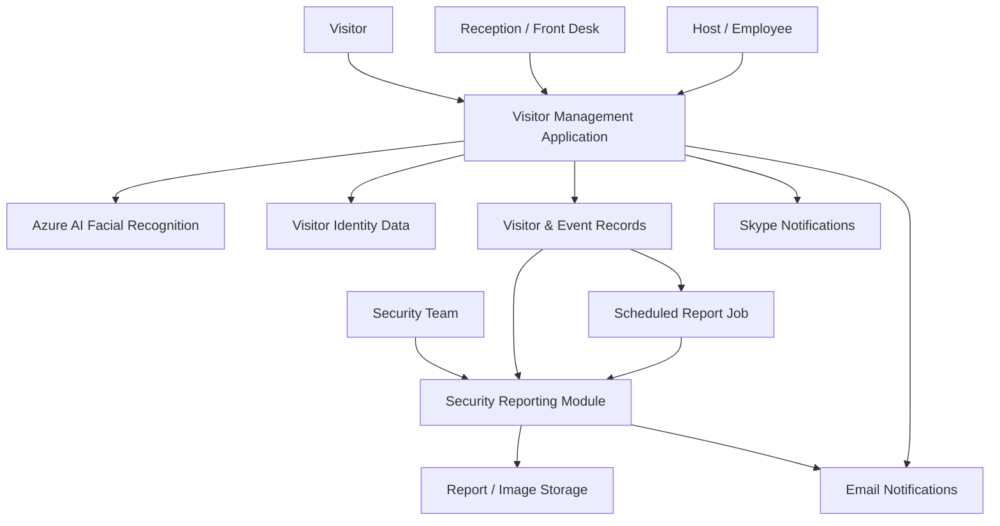

# AI-Enabled Digital Visitor Management & Security Transformation
## YPF — Visitor Management System | Phase III

### Project Overview

Phase III of YPF’s Visitor Management initiative focused on enhancing visitor registration, access control, security reporting, and operational efficiency through enterprise application improvements and AI-enabled security capabilities.

The project included the implementation of **AI-based facial recognition systems**, helping optimize security processes while supporting compliance with strict security policies and organizational directives.

The solution combined visitor-management workflows, identity-related information, automated reporting, and security-oriented AI capabilities within an enterprise environment.

> **Project context:** Historical implementation using the Azure AI capabilities available at the time.

---

## 1. Business Context & Objectives

The initiative addressed operational and security requirements associated with managing visitors in a corporate environment.

Key objectives included:

- Streamline visitor registration and access-related workflows.
- Improve identity-related security processes through AI-based facial recognition.
- Strengthen security monitoring and visitor traceability.
- Automate recurring security reports.
- Improve access to reporting capabilities for authorized operational roles.
- Support compliance with internal security policies and directives.
- Reduce manual effort across reception and security operations.

---

## 2. AI & Azure Integration

AI & Azure Integration — Facial Verification

The project incorporated AI-based facial verification using a 1:1 matching approach, comparing a visitor’s face against a previously registered photograph.

This capability was integrated into the visitor-management and security workflows using the Azure AI capabilities available at the time.

Functional Approach

Capture or obtain the visitor’s facial image during the security workflow.

Compare the captured face against the previously registered reference photograph.

Use facial similarity verification to support identity-related security processes.

Integrate the AI capability into the broader visitor-management solution.

Operate within strict organizational security policies and directives.

AI Architecture Perspective

The solution followed a facial verification (1:1) pattern, rather than identifying an individual by searching across a database of multiple faces (1 facial identification).

This distinction is important when describing the system’s architecture, security model, and functional scope.

Technology context: The implementation used Azure AI capabilities available at the time. The specific Azure service, API version, matching threshold, and biometric-data lifecycle should be documented only if confirmed.

---

## 3. Functional Scope — Phase III, Sprint 1

The documented Sprint 1 requirements included the following enhancements:

### Visitor & Host Notifications

- Notify the host when a visitor successfully enters the building.
- Support notifications through Skype and email.
- Allow notification channels to be selected during event creation.
- Enable both notification options by default.

### Identity Data & Visitor Information

- Replace the physical DNI image requirement in the visitor request workflow with a mandatory alphanumeric DNI/ID field.
- Support DNI/ID values up to 50 characters.
- Make the DNI/ID field optional in the guest lookup page.
- Remove the previous DNI image dependency from the specified workflows.

### Application Cache Management

- Resolve visitor-page behavior caused by cached content.
- Force the page to load fresh information rather than returning a previously cached page.

### Automated Security Reporting

Implement automatic generation of a daily security report:

- Schedule: weekdays at 19:00 Argentina Time.
- Exclude Saturdays and Sundays.
- Generate an Excel report containing visitors with an actual entry time but no recorded actual exit time.
- Email the report to the security mailbox.
- Send the report even when no matching visitors are found.

### Security Reporting & Visitor History

Create a dedicated Security Report page supporting:

- Visitor search.
- Display of the visitor’s latest selfie and DNI/ID.
- Date-range selection.
- Visitor and event history.
- Entry and exit timestamp visibility.
- PDF and Excel report downloads.

### Role-Based Reporting Access

- Enable the Receptionist role to access the Reports menu.
- Provide access to reporting capabilities comparable to those available to the Administrator role, according to the documented requirements.

---

## 4. Conceptual Solution Architecture

The following diagram represents the functional architecture and integration boundaries at a conceptual level. It is not a reconstruction of the exact deployed Azure infrastructure.

**Architecture considerations:**
- AI facial recognition is represented as a capability integrated with the visitor-management solution.
- The diagram does not assert a specific Azure AI API, database, storage service, or network topology.
- Identity data, biometric information, retention policies, and access permissions require particular attention in security-sensitive implementations.

---

## 5. Security, Privacy & Compliance Considerations

The project operated under strict security policies and organizational directives.

Relevant considerations included:

- Controlled access to visitor information and reports.
- Appropriate handling of identity-related data.
- Security-oriented reporting and visitor traceability.
- Alignment of AI-enabled functionality with organizational security policies.
- Consideration of data retention and access restrictions.

Facial recognition and biometric data are particularly sensitive. The exact consent model, retention controls, data residency, and compliance mechanisms should be documented only when verified against the implementation.

---

## 6. Requirements Engineering & Delivery

Phase III Sprint 1 included requirements definition and delivery planning for:

- Skype integration.
- DNI/ID data handling.
- Cache behavior.
- Automated security reports.
- Security reporting and visitor history.
- Receptionist reporting permissions.

The requirements established operational behavior, user-facing functionality, report content, and scheduled execution expectations.

---

## 7. Business & Operational Value

The project was designed to deliver value across visitor management and security operations:

- **Security process optimization:** AI-based facial recognition supported more efficient security workflows.
- **Operational efficiency:** Automated reports reduced dependency on manual reporting activities.
- **Improved traceability:** Visitor entry, exit, and event history became central to security reporting.
- **Enhanced visibility:** Security teams gained dedicated reporting and search capabilities.
- **Workflow integration:** Skype and email notifications improved host communication.
- **Access governance:** Reporting permissions were extended to the Receptionist role based on operational requirements.

These represent intended project benefits; quantified performance improvements were not available in the supplied requirements document.

---

## 8. Professional Experience & Contribution

This project demonstrates experience in:

- Enterprise visitor-management transformation.
- AI-based facial recognition integration.
- Azure AI technology adoption in a historical enterprise context.
- Security-oriented application requirements.
- Business process automation.
- Requirements analysis and sprint-level scope definition.
- Identity and visitor data workflows.
- Automated reporting and notifications.
- Enterprise application integration.
- Security and compliance-aware solution design.

---

## 9. Core Competencies

`AI Integration` · `Azure AI` · `Facial Recognition` · `Solution Architecture` · `Digital Transformation` · `Visitor Management` · `Security Workflows` · `Enterprise Applications` · `Requirements Engineering` · `Process Automation` · `Reporting & Analytics` · `Identity Data Management`

---

## 10. Confidentiality Notice

This case study is a high-level professional summary. It excludes confidential implementation details, proprietary source code, internal security procedures, and sensitive architectural information.

Before publishing client names, project details, or materials derived from internal documentation, confirm that disclosure is permitted by the applicable confidentiality and intellectual-property agreements.
