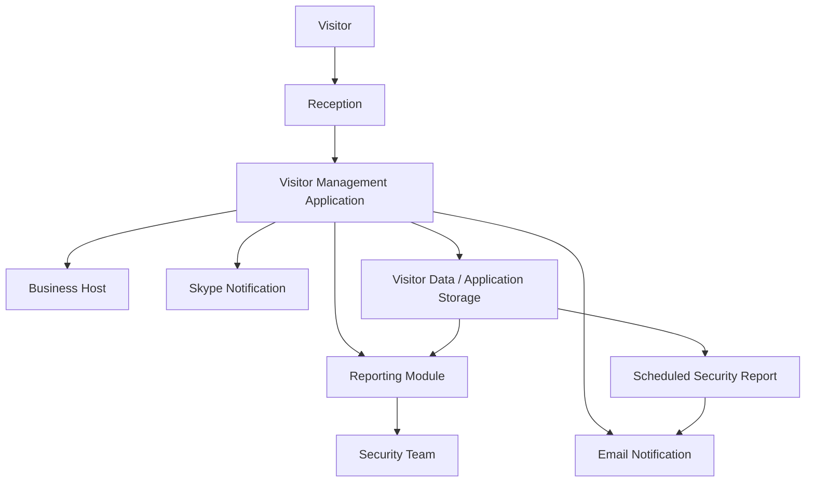

# Enterprise Application Transformation & Digital Visitor Management
## YPF | Visitor Management System — Phase III

**Client:** YPF  
**Engagement:** Visitor Management System — Phase III  
**Role Perspective:** Digital Transformation Consultant / Solution Architecture & Business Analysis  
**Delivery Approach:** Agile Development / Sprint-Based Requirements Engineering  
**Technology Context:** Enterprise Applications, Microsoft Azure, Azure AI (historical technology context), Skype Integration, Automated Reporting

---

## 1. Executive Overview

Participated in the Phase III evolution of YPF's Visitor Management System (Gestión de Visitas), an enterprise application designed to support visitor registration, reception operations, host notifications, and security-related processes.

The engagement focused on translating operational and security requirements into functional enhancements, improving user experience, automating reporting workflows, and extending application capabilities across different user roles.

The Sprint 1 scope involved requirements analysis, functional specification, application behavior assessment, and the definition of enhancements addressing visitor identity management, communication integration, reporting automation, and security information accessibility.

The project represented an incremental digital transformation initiative aimed at improving operational efficiency, user experience, and security-related information management.

## 2. Business & Functional Discovery

The Discovery and requirements analysis addressed several operational scenarios involving:

- Visitor registration and identification.
- Host notification workflows.
- Reception and security operations.
- Visitor entry and exit tracking.
- Security reporting.
- Role-based access to reporting capabilities.
- Automated operational reporting.

The requirements were structured around user scenarios, application behavior, business rules, and expected outcomes.

## 3. Sprint 1 — Functional Scope

### 3.1 Communication & Host Notifications

Extended the existing visitor notification workflow to support Skype notifications in addition to email.

Key requirements included:

- Host notification when a visitor successfully enters the building.
- Integration of Skype-based notifications into the existing workflow.
- Configurable notification preferences during event creation.
- Support for email, Skype, or both notification channels.
- Preservation of the existing email notification capability.

This enhancement focused on improving communication efficiency and reducing dependency on a single notification channel.

### 3.2 Visitor Identity Management & Data Protection

The Discovery identified a requirement to replace the collection and storage of physical identity document photographs with a document identification number.

Functional improvements included:

- Removal of identity document photograph capture.
- Replacement with an alphanumeric DNI/ID input field.
- Mandatory validation during visitor data submission.
- Input validation and error handling.
- Modification of visitor information consultation screens.
- Alignment with company requirements regarding identity document data storage.

This enhancement represented a privacy-oriented application change, reducing the need to retain physical identity document images.

### 3.3 Application Cache Management

Identified an application behavior affecting the visitor information page, where cached data could return previously loaded content.

The requirement focused on:

- Disabling the existing cache behavior on the visitor page.
- Forcing the application to retrieve a fresh page.
- Improving information freshness and consistency.

This change addressed a user-facing application behavior rather than a broader infrastructure-level caching architecture.

### 3.4 Automated Security Reporting

Defined requirements for an automated daily security reporting process.

The proposed functionality involved:

- Scheduled execution at 19:00 Argentina time.
- Weekday execution, excluding Saturdays and Sundays.
- Identification of visitors who entered the building but had no recorded actual departure time.
- Automated generation of an Excel report.
- Email distribution to the designated security mailbox.
- Inclusion of host, visitor, DNI, scheduled departure, floor, room, and contact information.
- Delivery of an empty report when no matching records were found.

This enhancement introduced scheduled reporting automation to support security personnel and operational monitoring.

### 3.5 Security Reporting & Historical Visitor Tracking

Defined a new security reporting interface to provide visibility into visitor activity and recorded attendance.

Functional requirements included:

- Visitor selection.
- Visitor identification through DNI/ID.
- Preview of the visitor's most recent selfie.
- Date-range selection.
- Historical visitor attendance information.
- Event and meeting details.
- Recorded entry and exit times.
- On-screen report results.
- PDF and Excel export capabilities.

The objective was to improve information accessibility and enable security personnel to retrieve visitor history without relying on manual data extraction.

### 3.6 Role-Based Reporting Access

Identified a restriction preventing Receptionist users from accessing reports available to Administrators.

The enhancement required:

- Extending report menu access to the Receptionist role.
- Enabling report usage under the corresponding authorization model.
- Improving operational accessibility for reception personnel.

This requirement involved application permissions and role-based functionality.

---

## 4. Solution Architecture Perspective

The Phase III assessment focused on incremental evolution of an existing enterprise application.

Key architectural considerations included:

- Integration with external communication services.
- Application workflow enhancement.
- Identity data handling.
- Scheduled background processing.
- Automated report generation and distribution.
- User-role permissions.
- Data retrieval and cache behavior.
- Reporting and export capabilities.

### Conceptual Application Flow

*Conceptual functional representation based on the documented requirements, not a verified production architecture.*

---

## 5. Azure & AI Technology Context

The project took place in the context of Microsoft Azure capabilities and the AI technologies available at that time.

The technology context is relevant to the broader digital transformation and enterprise application landscape.

However, the Sprint 1 requirements document does not explicitly describe an AI-powered feature, model, endpoint, or architecture.

Therefore, specific AI capabilities, model versions, or implementation responsibilities should be documented separately if confirmed through additional project artifacts.

This distinction preserves the technical accuracy of the case study while acknowledging the historical Azure AI context.

---

## 6. Delivery & Requirements Engineering

The Sprint 1 requirements were organized around functional enhancements and operational scenarios.

The documented scope included:

- Business requirements analysis.
- Functional specification.
- User experience and application behavior definition.
- Validation rules and error scenarios.
- Reporting requirements.
- Integration requirements.
- Scheduled process requirements.
- User-role access requirements.

The requirements were structured to support Agile sprint delivery and implementation planning.

## 7. Business Value & Transformation Outcomes

The identified enhancements targeted several operational improvements:

- Improved host communication.
- Reduced identity document image retention.
- Increased information freshness.
- Automated security reporting.
- Improved visitor history accessibility.
- Enhanced reporting capabilities.
- Expanded operational access for reception personnel.
- Reduced manual reporting effort.
- Improved security process visibility.

These represent intended business benefits associated with the documented requirements rather than independently measured implementation outcomes.

---

## 8. Professional Contribution

The engagement involved enterprise application enhancement and functional transformation, connecting business requirements with application behavior, integration capabilities, reporting processes, and operational security needs.

The project provided experience in requirements-driven application evolution, stakeholder-oriented functional analysis, enterprise integration considerations, and Agile delivery.

### Core Competencies

`Digital Transformation`  
`Solution Architecture`  
`Enterprise Application Architecture`  
`Business Analysis`  
`Requirements Engineering`  
`Agile / Sprint Planning`  
`Enterprise Integration`  
`Microsoft Azure`  
`Azure AI Technology Context`  
`Application Workflow Design`  
`Automated Reporting`  
`Role-Based Access Control`  
`Data Privacy Considerations`  
`Visitor Management`  
`Security Operations`

---

## Confidentiality & Scope Disclaimer

This case study summarizes the documented requirements and functional scope of the Visitor Management System — Phase III.

It does not claim implementation of undocumented features, specific AI models, or measured business outcomes.

Proprietary architecture, confidential operational information, and internal implementation details have been excluded.
